# 6 lb Combat Robot

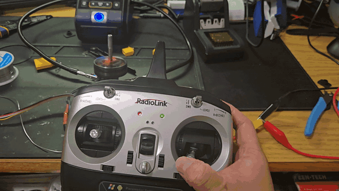

Electrical lead for a 6 lb spinner that placed 2nd of 16 teams. Power, motor control, radio, and the analysis behind the weapon and chassis.

| Context | Dates | My role | Scope | Tools | Outcome |
|---|---|---|---|---|---|
| ASME combat robotics team, Cntrl Alt Defeat | Fall 2025 to April 2026 | Electrical subsystem lead | Power, motor control, radio, weapon and chassis analysis | SolidWorks mass properties, Desmos, wiring design | 2nd of 16 teams |

**Case study:** [PDF](docs/Combat_Robot_Case_Study.pdf) · [web version](https://xiang-wang-us.github.io/projects/combat-robot.html)

## Highlights

- **2nd** of 16 teams
- **22.2 V** weapon bus from two 3S packs in series
- **about 6,000 rpm** weapon speed needed for 500 J

## Summary

I owned the electrical system of a 6 lb combat robot: battery architecture, weapon and drive motor control, radio, and the harness. I also wrote the two analyses that shaped the weapon and the chassis: an energy based speed requirement for the weapon motor and an assessment that ruled out an all TPU chassis. The robot placed 2nd of 16.

## Electrical architecture

Two 3S 2200 mAh LiPo packs run in series to put 22.2 V on the weapon ESC and its brushless outrunner. A dual channel ESC drives the two drive motors from 11.1 V. Both ESCs take commands from a RadioLink receiver.

I built the harness with XT connectors throughout and bench tested the receiver and both ESCs with the transmitter before anything went into the chassis.

<table>
<tr><td width="50%" valign="top">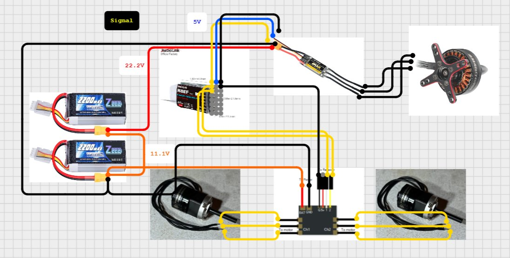 Wiring diagram</td><td width="50%" valign="top">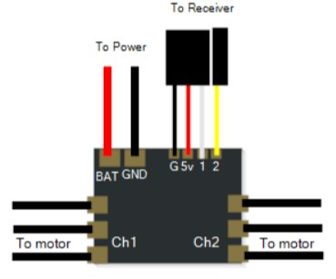 Drive ESC connections</td></tr>
</table>

Videos: [Drive ESC and receiver bench test](media/video/bot_esc_test.mp4)

## Weapon speed requirement

Weapon energy was the limiting factor, so I started from stored energy, E equals one half I omega squared. With energy capped, the required speed falls as the weapon's moment of inertia rises. I took mass properties for three 4130 steel candidates from SolidWorks and placed them on curves from 100 to 500 J.

At 500 J the candidates need between about 5,970 and 6,390 rpm. That range is the speed the weapon motor had to reach.

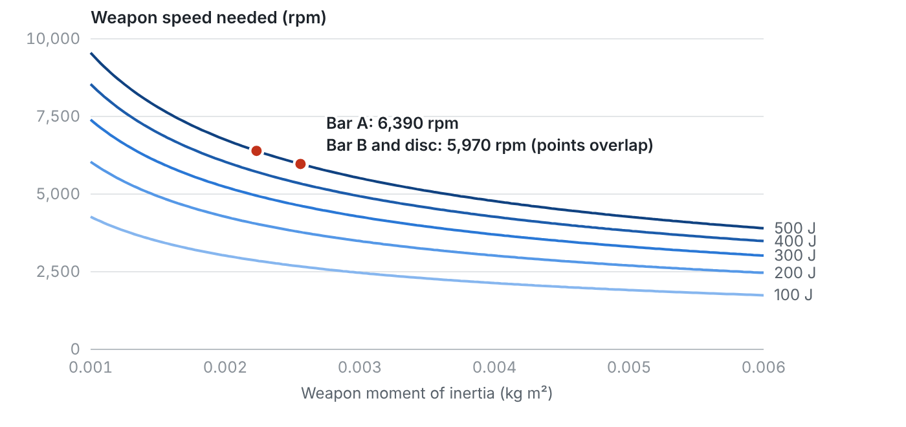 Weapon speed needed to store 100 to 500 J, with the three steel candidates

<table>
<tr><td width="50%" valign="top">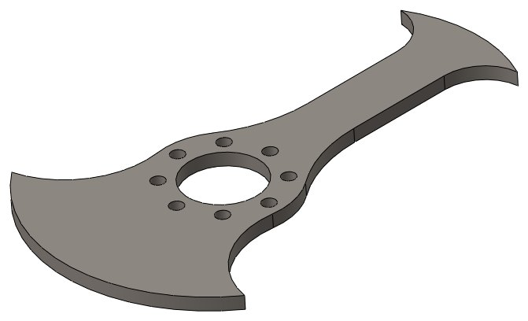 Bar A, 493 g</td><td width="50%" valign="top">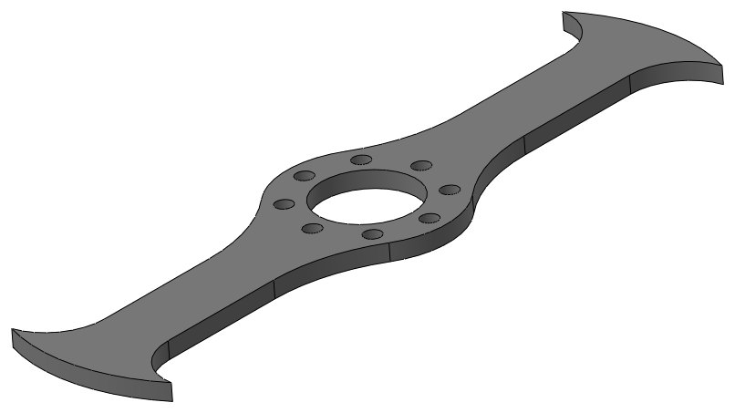 Bar B, 400 g</td></tr>
<tr><td width="50%" valign="top">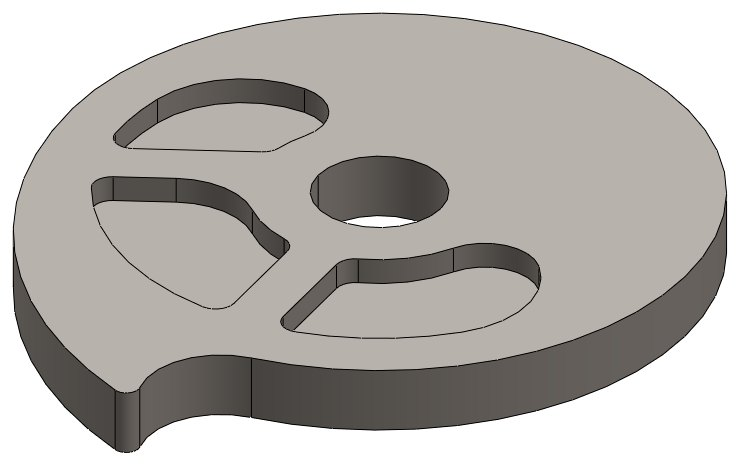 Disc, 1,049 g</td></tr>
</table>

## Chassis material assessment

A TPU only chassis was proposed for its impact absorption. I wrote an assessment arguing against it. TPU's modulus is roughly 10 to 100 MPa against about 70 GPa for aluminum, so a TPU frame flexes enough to misalign shafts and weapon mounts. It also creeps under sustained load, lets threaded inserts pull out under shock, and softens near 80 to 100 C, which motors and ESCs can reach.

The recommendation was a rigid structure with TPU only where it helps: bumpers, electronics mounts, and abrasion covers. The final robot used an aluminum chassis.

<table>
<tr><td width="50%" valign="top">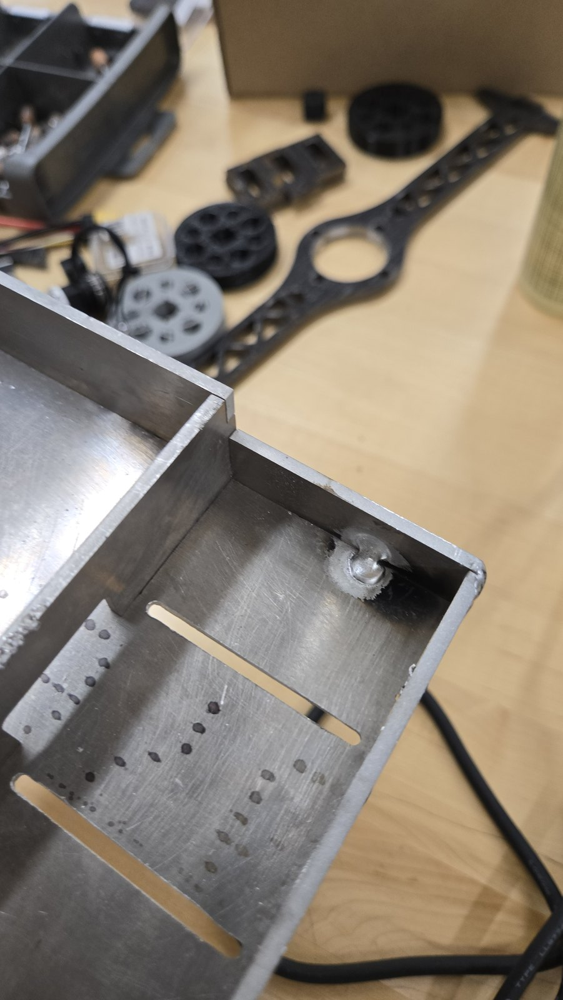 Aluminum chassis during fabrication</td><td width="50%" valign="top">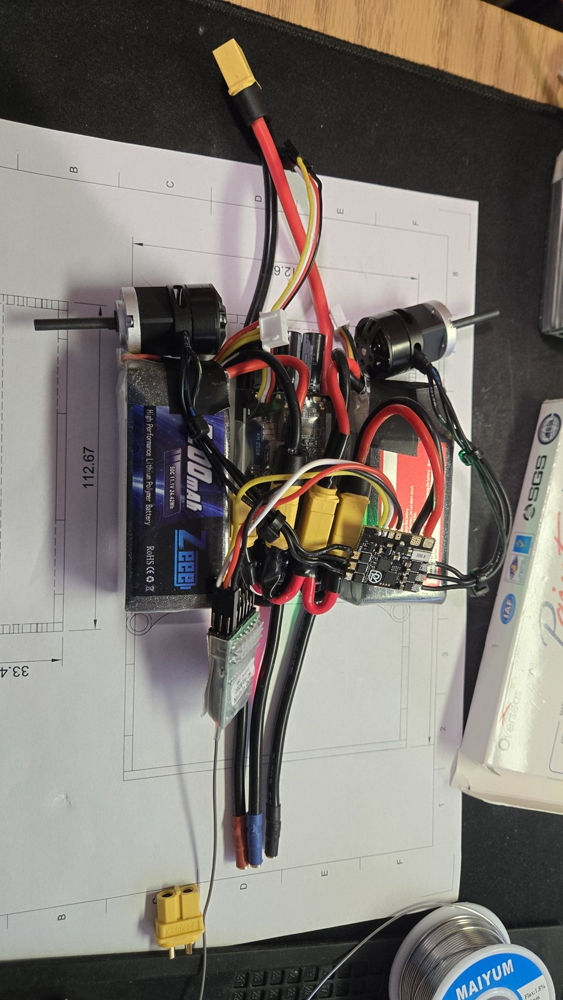 Drive and weapon electronics on the bench</td></tr>
<tr><td width="50%" valign="top">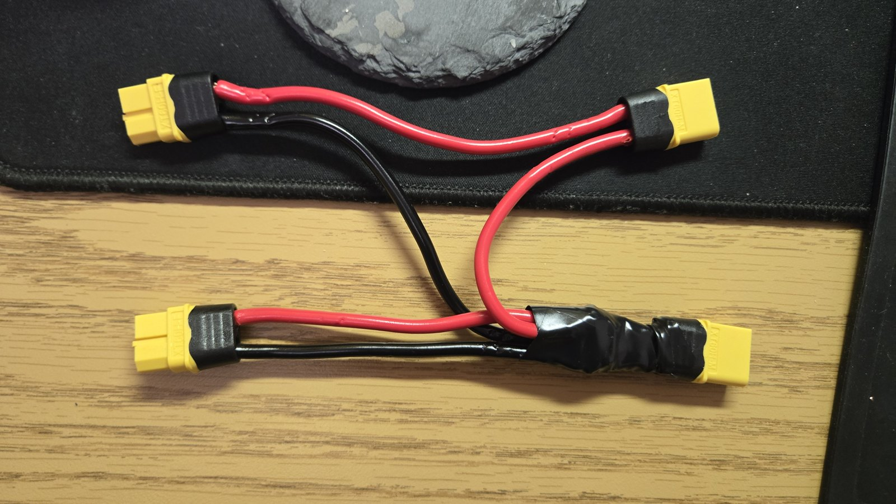 Series harness for the weapon packs</td></tr>
</table>

## Testing and competition

The weapon motor was spun up on the bench from the transmitter before the chassis was closed. At the April 2026 competition the robot placed 2nd of 16 teams.

<table>
<tr><td width="50%" valign="top">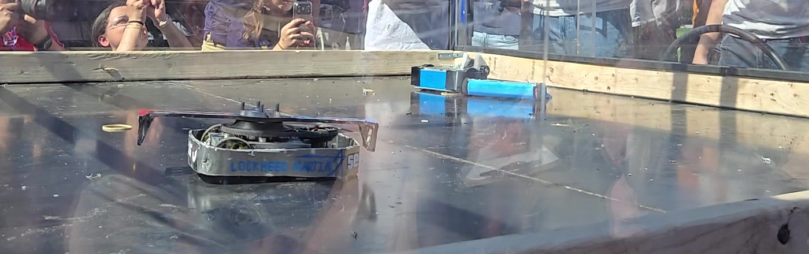 Match at the April 2026 competition</td><td width="50%" valign="top">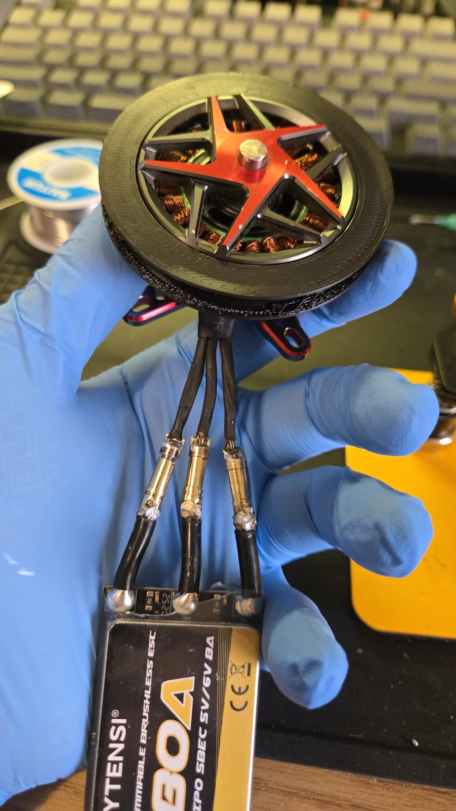 Weapon outrunner and ESC</td></tr>
</table>

Videos: [Weapon spin up on the bench](media/video/bot_weapon_spinup.mp4), [Match footage](media/video/bot_fight.mp4)

## Files

| File | Path |
|---|---|
| Case study (PDF) | [`docs/Combat_Robot_Case_Study.pdf`](docs/Combat_Robot_Case_Study.pdf) |
| TPU chassis assessment (PDF) | [`docs/TPU_Chassis_Assessment.pdf`](docs/TPU_Chassis_Assessment.pdf) |
| Armor and chassis assembly (STEP) | [`cad/Armor_Assembly.step`](cad/Armor_Assembly.step) |

## Credits

Team Cntrl Alt Defeat, led by Cole Thomas. Chassis designed by teammate Jerry.

---

Part of [Xiang Wang's engineering portfolio](https://xiang-wang-us.github.io). [LinkedIn](https://linkedin.com/in/xiangwang102) · [Email](mailto:20o5xwang@gmail.com)
